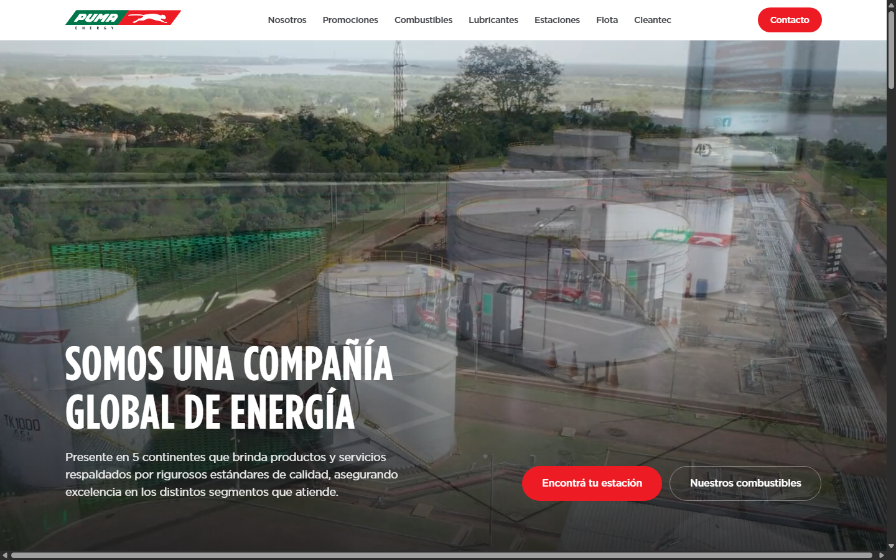
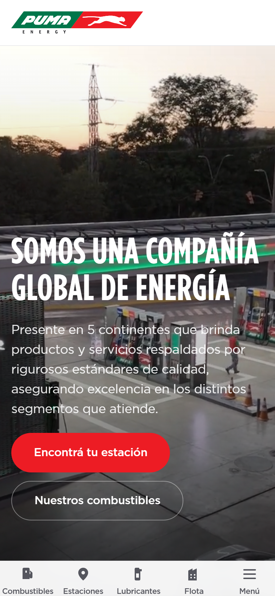
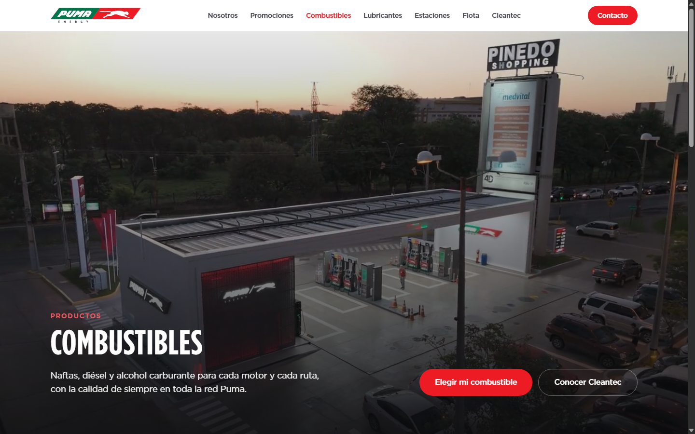
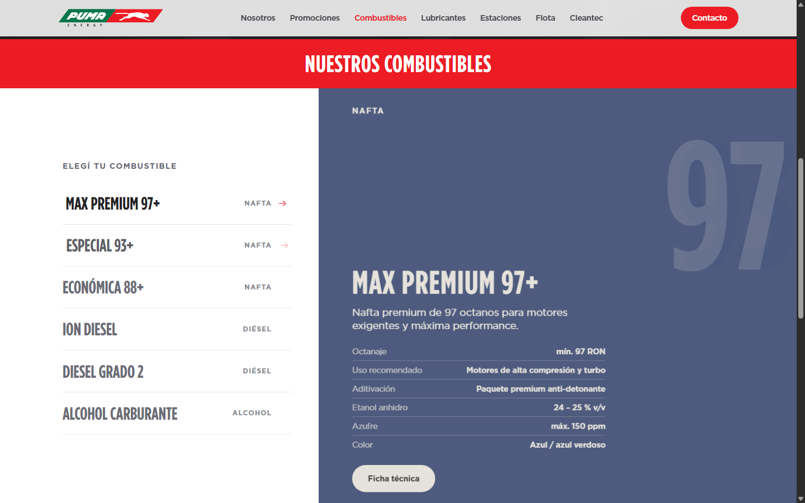
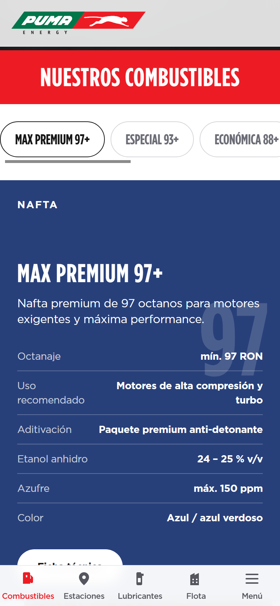
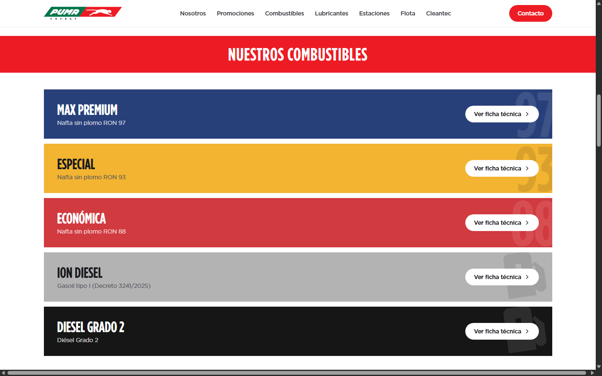
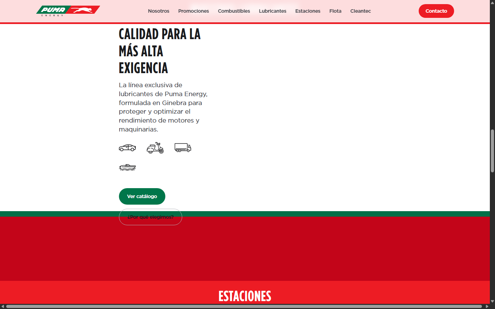
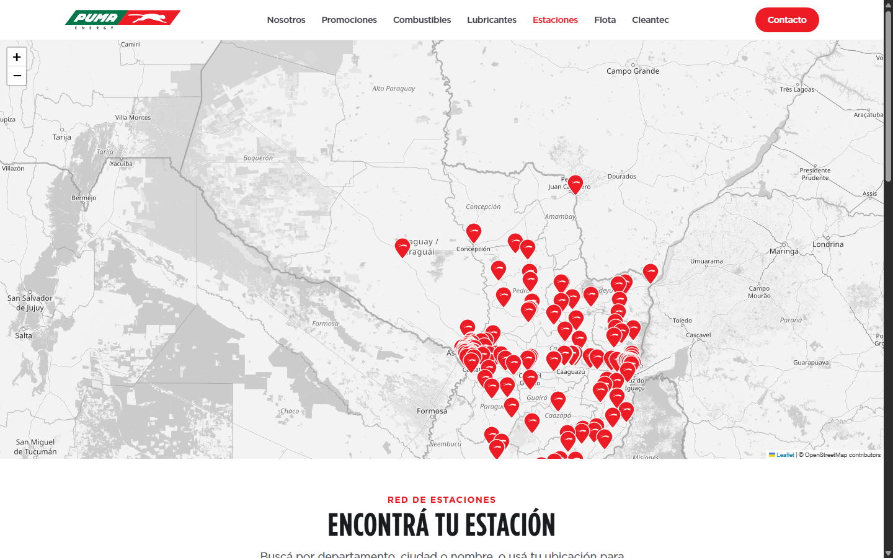
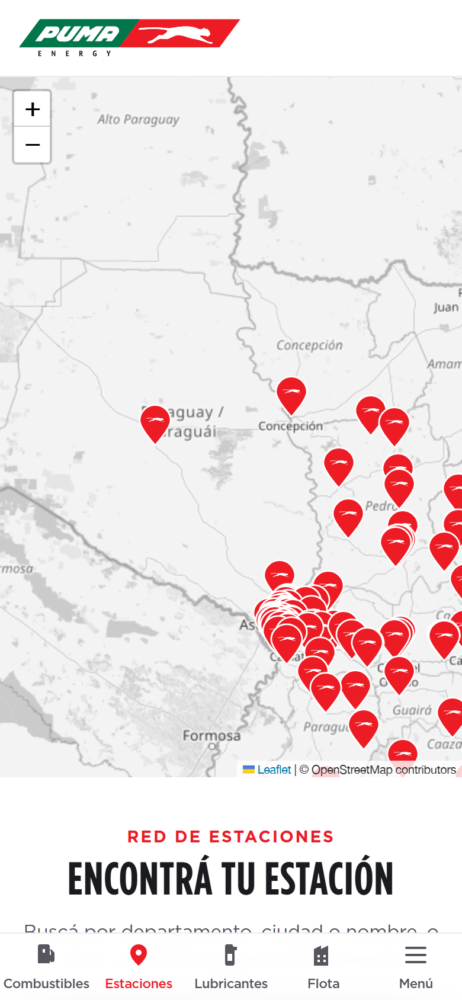
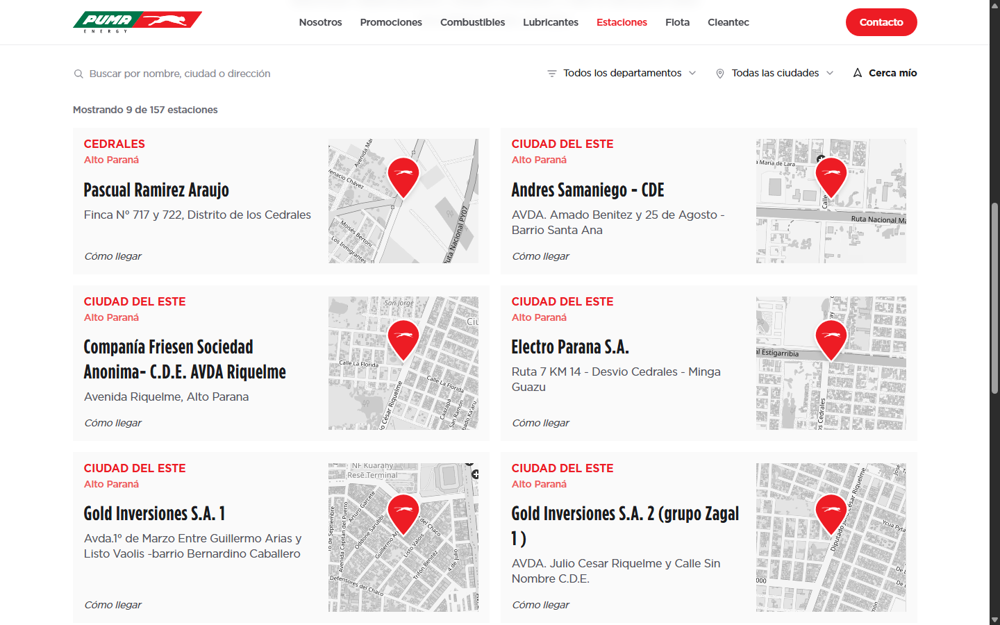

# Puma Energy Paraguay · Rediseño del sitio web

**Caso de diseño de producto.** Rediseño completo del sitio público de una empresa de combustibles y lubricantes: de una página única de 2018 a un sitio navegable donde encontrar una estación, elegir un combustible o conocer los servicios para flotas.

**[Ver el sitio en vivo →](https://puma-energy-py.vercel.app)**

| | |
| --- | --- |
| **Rol** | Diseño de producto, arquitectura de información, diseño visual y desarrollo front-end |
| **Contexto** | Rediseño 2026 del sitio de Puma Energy Paraguay, proyecto de GDigital. Cronograma: 20 de julio al 15 de septiembre de 2026 |
| **Público** | Conductores particulares, empresas con flota y quienes buscan información de la marca |
| **Alcance** | Solo front-end. El backend, el CMS y la infraestructura los hace otro equipo |
| **Stack** | Astro 5 · Tailwind CSS 4 · TypeScript · Leaflet · Vitest · Vercel |
| **Estado** | Prototipo publicado en Vercel. Pendiente de validación con el cliente, contenido definitivo de promociones y dominio final |

> El código vive en un repositorio privado. Este repositorio documenta el proceso y las decisiones.

---

## 1. El problema

El sitio anterior era una página estática de 2018: HTML plano, Bootstrap 3, jQuery cargado dos veces y un slider ya discontinuado. Cumplía lo mínimo informativo, pero tenía problemas concretos que salieron de auditarlo:

- **Seguridad:** el formulario de contacto enviaba por HTTP sin cifrar y la clave de la API de Google Maps estaba expuesta en el HTML.
- **Peso:** imágenes de hasta 12,3 MB sin optimizar, en JPG y PNG, sin versiones responsivas.
- **Contenido atrapado en imágenes:** las fichas de naftas y lubricantes eran imágenes con el texto quemado. No se podían leer con lector de pantalla, ni indexar ni traducir.
- **Sin estructura:** todo vivía en la home. La página de estaciones era casi un PDF con un mapa embebido.
- **SEO básico ausente:** ninguna de las 8 páginas tenía `<h1>` ni meta descripción.
- **Marca diluida:** tipografías ajenas a la guía de marca y un sistema visual inexistente.

Quien llega al sitio quiere resolver algo concreto: dónde cargar, qué combustible le conviene, qué lubricante usar, cómo contratar para su flota. El sitio anterior no ayudaba a ninguna de esas tareas.

## 2. Qué se pidió

- Reconstruir el sitio desde cero conservando el **contenido** y descartando el maquetado.
- Respetar la identidad de marca: blanco como lienzo dominante, rojo y verde como acento.
- Un **localizador de estaciones** real, sin depender de la API de Google Maps.
- Fichas de producto como texto, no como imagen.
- Tomar como referencia de ritmo y jerarquía un sitio de relojería premium, sin copiarlo.

## 3. Principios de diseño

**La marca manda, el color acentúa.**
Lienzo blanco, titulares en Gotham Condensed en mayúsculas y rojo institucional solo para acciones y énfasis. La paleta sale de la guía de marca y vive en tokens, no en valores sueltos.

**Cada pantalla resuelve una tarea.**
La portada abre con una frase y dos botones: *Encontrá tu estación* y *Nuestros combustibles*. Son las dos cosas que más se buscan.

**Contenido como datos, no como imagen.**
Las fichas de combustibles y lubricantes son archivos JSON validados. Texto real que se lee, se indexa y se actualiza sin tocar componentes.

**Mapa útil antes que mapa bonito.**
El localizador filtra por departamento, ciudad o nombre, ofrece *Cerca mío* y cada estación tiene su enlace *Cómo llegar*.

**Movimiento con criterio.**
Animaciones de aparición discretas que respetan `prefers-reduced-motion`.

## 4. El sitio

### Portada
Video a sangre completa, titular condensado, una frase y dos acciones. En celular el contenido se apila y aparece una barra inferior fija con los cuatro destinos más usados y un menú.

| Escritorio | Celular |
| --- | --- |
|  |  |

### Combustibles
Una entrada por producto, cada una con su color: Max Premium 97+, Especial 93+, Económica 88+, ION Diésel, Diésel Grado 2 y Alcohol carburante.

El **explorador** reemplaza las fichas en imagen. A la izquierda se elige el combustible; a la derecha aparecen octanaje, uso recomendado, aditivación, etanol, azufre y color, más un botón a la ficha técnica en PDF.

En celular las opciones pasan a una fila de pestañas que se desliza, y la ficha ocupa el ancho completo.

En la home los mismos productos se muestran como barras de color con acceso directo a la ficha.

### Lubricantes
Catálogo de 81 productos con ficha propia y una clasificación propia. La home los presenta con la gama a escala y accesos a *Ver catálogo* y *¿Por qué elegirnos?*.

### Estaciones
157 estaciones sobre un mapa de Leaflet con teselas de OpenStreetMap, sin clave de API ni costo. Los pines usan el felino de la marca y se agrupan según el zoom.

| Escritorio | Celular |
| --- | --- |
|  |  |

Debajo del mapa, buscador y filtros, y una tarjeta por estación con su mapa pequeño y el enlace *Cómo llegar*.

### Otras páginas
Nosotros, Promociones, Puma Flota, Cleantec, Contacto, y las páginas legales de términos y privacidad.

## 5. Decisiones y qué se descartó

| Tema | Recorrido | Resultado |
| --- | --- | --- |
| Referencia visual | Se analizó el recorrido en video de una página de relojería premium. Se tomó el ritmo vertical, la jerarquía tipográfica y los reveals sobrios. Se descartaron la tarjeta de compra fija y las secciones oscuras alternadas | Lienzo blanco con acentos de marca, sin tarjeta fija |
| Tipografía | La guía de marca pedía una familia con serif para titulares. Las fuentes disponibles eran Gotham y Gotham Condensed | Gotham Condensed para titulares y Gotham para cuerpo, cargadas desde el propio sitio |
| Estaciones | PDF y mapa embebido → mapa propio con búsqueda | Leaflet, 157 estaciones, filtros y geolocalización opcional |
| Fichas de producto | Imagen con texto → contenido en JSON validado en el build | El esquema valida los campos en el build y las pruebas verifican que existan imágenes y fichas |
| Estilos | SCSS Modules en el plan inicial → Tailwind 4 con tokens | Un solo bloque de tokens controla color, tipografía, radios y tiempos de animación |
| Datos de estaciones | Consumirlos de una API del backend → archivo JSON generado desde el Excel del cliente | Se desarrolló sin depender del otro equipo. La interfaz de datos queda lista para cambiar de origen |

**Trabajo de contenido.** El listado de estaciones llegó como una planilla de Excel. Se escribió un script que la convierte en JSON, y una prueba verifica que todas las coordenadas caigan dentro de Paraguay y que los identificadores no se repitan.

## 6. Pensado para mantenerse

- **Tokens centralizados:** cambiar un valor en un archivo lo cambia en todo el sitio.
- **Contenido separado del marcado:** agregar un combustible o un lubricante es sumar un archivo JSON y una imagen.
- **Verificaciones con un solo comando:** chequeo de tipos, ESLint, 120 pruebas y build.
- **Pruebas sobre el sitio construido:** enlaces internos sin destino roto, imágenes con `alt`, `rel="noopener"` en enlaces externos y la página técnica interna fuera del sitemap.
- **Seguridad:** HSTS, `nosniff`, `X-Frame-Options`, `Referrer-Policy` y `Permissions-Policy` definidos, caché larga para los archivos con hash, y datos incrustados en el HTML escapados para que no puedan cerrar el script.

## 7. Lo que falta (y por qué lo digo)

Un sitio se valida con quienes lo usan. Esto todavía no está hecho:

- **No hubo pruebas de uso.** Las decisiones se apoyan en la auditoría y en criterios de accesibilidad, no en observar a conductores o responsables de flota.
- **Sin medición de rendimiento.** No hay mediciones de Lighthouse ni de Core Web Vitals en este caso, y falta una revisión con lector de pantalla.
- **Promociones con contenido de ejemplo.** La sección de promociones de la home todavía muestra piezas de otro mercado. Hay que reemplazarlas por las promociones vigentes en Paraguay.
- **Desviación de la dirección de arte.** La regla era blanco dominante, pero los héroes con video y la banda de Cleantec van sobre fondo oscuro. Hay que decidir con la marca si se mantiene.
- **Estaciones, promociones y blog desde el CMS.** Hoy las estaciones salen de un JSON. La conexión con la API del otro equipo está planteada pero no implementada.
- **Dominio definitivo** y reglas de indexación por definir.

## 8. Qué me llevo

- Auditar antes de diseñar ordena el trabajo: casi todas las decisiones salieron de un problema concreto del sitio anterior.
- Pasar el contenido de imagen a datos no es un detalle técnico. Es lo que vuelve el sitio accesible, indexable y actualizable.
- Una referencia sirve para aprender de ritmo y jerarquía, no para copiar estructura. Descartar lo que choca con la marca es parte de usarla bien.
- Mirar lo publicado con ojos de revisor encuentra lo que el desarrollo no ve. Al preparar este caso encontré un desborde horizontal en celular en la página de combustibles. La causa era una columna de grilla sin ancho definido. Quedó corregido con dos clases, y lo medí en el sitio publicado.

---

© Puma Energy. Marca, identidad e imágenes pertenecen al cliente. Este repositorio presenta el caso con fines de portfolio.
